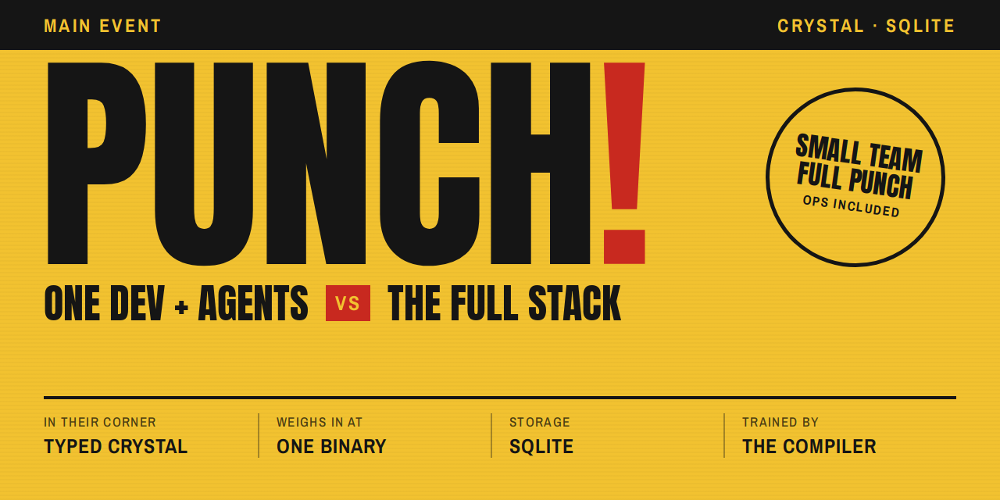

# Punch guides

The guides teach Punch by task, from a first app to running one in production. Each says up front what you will know after reading it, quotes working code from the reference app, and ends with its rules. For every option of a feature, follow its link to the reference page.

Punch 0.x is not released: anything may change between minor versions.

## Start here

- [Introduction: What Punch Is](introduction.md): what Punch is, its principles, what an app is in production, who it is for and not for, and where to start.
- [Crystal for Punch Developers](crystal-for-punch-developers.md): the Crystal a Punch app uses, and the Ruby habits that do not carry over.
- [How a Punch App Works](how-a-punch-app-works.md): one request from the socket to the response and into the background, the storage directory, the two binaries, and the checks.
- [Application Structure](application-structure.md): slices, namespaces, and entities, where each kind of file goes, outlines, and generated requires.
- [Glossary](glossary.md): the words the guides and Punch's messages use, one definition each.

## Operations and HTTP

- [Operations and Routing](operations-and-routing.md): Queries and Commands, how names become routes, typed paths, what `call` can ask for, and pages sharing paths with Queries.
- [Results, Errors, and Status Codes](results-errors-and-status-codes.md): outcomes as types, statuses, Problem Details, violations as field errors, rollback, messages, and exceptions.
- [Input and Domain Types](input-and-domain-types.md): parse at the boundary, trust inside; inputs, rejections, domain primitives, typed IDs, money, and secrets.
- [Building a JSON API](building-a-json-api.md): the committed openapi.json, breaking changes, idempotency keys, 304 answers, tokens, and generated clients.

## Models and Data

- [SQLite in Punch](sqlite-in-punch.md): the storage directory, readers and the writer, local disk, inspecting a database, and how far one machine goes.
- [Migrations](migrations.md): writing migrations, db/schema.sql, forward only, what a migration costs, keeping the previous release working, and Punch's own tables.
- [Named Queries and Generated Code](named-queries.md): SQL in .sql files, generated methods, columns.cr, records and Table, and uniqueness as a typed result.
- [Domain Models](domain-models.md): a model decides and an operation orchestrates; records, state types, stores, and where each rule goes.
- [Text and Sort Order](text-and-sort-order.md): normalization, collations in the schema, case-insensitive search beyond ASCII, and collation versions.
- [Keeping SQL Safe and Fast](keeping-sql-safe-and-fast.md): no values in SQL text, declared sorts and filters, LikeText, query plans, and auditing stored values.

## Pages and the Browser

- [Pages and Components](pages-and-components.md): pages that call operations, components instead of templates, layouts, typed links, and page specs.
- [Forms](forms.md): forms bound to Commands, 303 or the page again, field errors, rows, and idempotent forms.
- [Assets and JavaScript](assets-and-javascript.md): fingerprinted assets, stylesheets, ES modules through the import map, Turbo, and the Content-Security-Policy.
- [Turbo Frames, Streams, and Live Pages](turbo-frames-streams-and-live-pages.md): frames, streams, and live pages decided per viewer.
- [Translations and Formats](translations-and-formats.md): locale files, generated accessors, languages, messages from codes, and formats.
- [Pages for Agents](pages-for-agents.md): pages as markdown, action blocks, /llms.txt, and tokens for agents.

## Background Work and Integration

- [Domain Events](domain-events.md): events as facts, publishing from Commands, the three deliveries, the event graph, and testing events.
- [Background Jobs](background-jobs.md): moving work out of the request, the outbox, jobs that run twice safely, schedules, concurrency limits, payload versions, and testing jobs.
- [Mail](mail.md): mail as a component, sending from a job in the recipient's language, settings, captured mail, and testing mail.
- [Inbound Webhooks](inbound-webhooks.md): providers, receiving first and processing later, signatures, duplicates, failures, and testing deliveries.
- [Caching](caching.md): what to cache, stores and fetch, forgetting by events, correctness with an empty cache, and conditional requests.

## Security

- [Securing Punch Applications](securing-punch-applications.md): what Punch handles for you, what stays yours, the checks that fail, proxies, and a checklist before going live.
- [Authentication](authentication.md): the actor, sessions and API tokens, checking passwords outside the transaction, mailed links, the second factor, and the cross-site check.
- [Authorization and Roles](authorization-and-roles.md): policies on every operation, 404 versus 403, grants, pages that ask the same policy, lists in SQL, and roles per organization.
- [Credentials and Keys](credentials-and-keys.md): declaring what the app needs, where values come from, the creds commands, signing stateless links, and rotating keys.
- [Rate Limits](rate-limits.md): limits on operations, choosing keys and stores, 429 answers, limits on open Commands, unlocking, and testing.

## Running in Production

- [Configuring Punch Applications](configuring-punch-applications.md): settings versus credentials, punch config, how a bad setting stops the boot, and the settings that matter in production.
- [Deploying](deploying.md): the binary and its image, how a deploy hands over without dropping requests, Kamal, Caddy and systemd, and checks after a deploy.
- [Backup and Restore](backup-and-restore.md): turning backups on, checking replication, the nightly restore check, the restore runbook, and recovery mode.
- [Tracing and Metrics](tracing-and-metrics.md): wide events per request and job, seeing traces, adding fields and spans, exporting over OTLP, and the metrics to watch.
- [The Ops Console and punch ops](the-ops-console.md): access by role, what the console shows, punch ops, runbooks, alerting by events, and agents.

## Testing and Tooling

- [Testing Punch Applications](testing-punch-applications.md): a fresh database per example, endpoint specs and the contract check, background work, clocks, and what to test at which level.
- [punch check and the Command Line](punch-check-and-the-command-line.md): the two binaries, the development loop, every check and its honest fix, --json, and CI.
- [When the Compiler Says No](when-the-compiler-says-no.md): reading compile errors, the most common messages and their honest fixes, and what punch check reports.

## Working Styles

- [Coming from Rails](coming-from-rails.md): where each part of a Rails app maps in a Punch app, and what Punch deliberately lacks.
